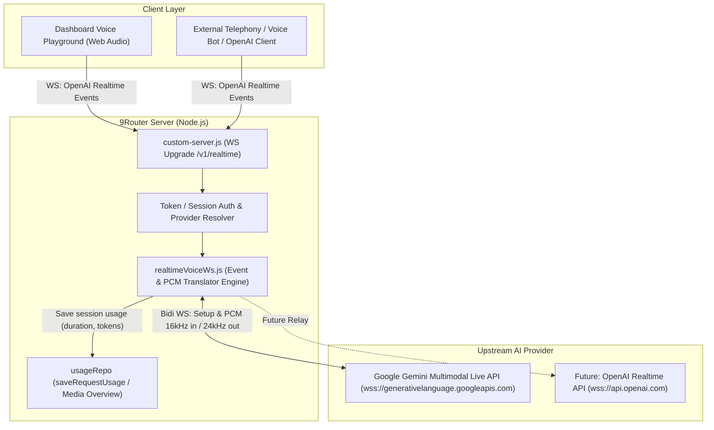

# Design Specification: Realtime Voice Agent API for 9Router

- **Date:** 2026-10-15
- **Status:** Approved (Approach A)
- **Author:** Antigravity & User

---

## 1. Overview & Objectives

This feature introduces a **Realtime Voice Agent Gateway** to 9Router, exposing an **OpenAI-compatible WebSocket endpoint** (`/v1/realtime`) backed by the **Google Gemini Multimodal Live API** (`BidiGenerateContent`).

### Key Goals:
1. **Industry-standard Protocol**: Expose standard OpenAI Realtime events (`session.update`, `input_audio_buffer.append`, `response.audio.delta`) so any client (browsers, telephony bots like Telegent, LiveKit, or custom apps) can connect out-of-the-box.
2. **Cost-Effective & High-Performance Engine**: Leverage Google Gemini 2.0 Flash (`gemini-2.0-flash-exp` / `gemini-2.0-flash-realtime`) for ultra-low latency, natural voice interactions with Indonesian and English support.
3. **Seamless 9Router Integration**:
   - Register `realtime` as an official media kind in `MEDIA_PROVIDER_KINDS`.
   - Track usage (audio duration, requests, tokens) under `type: "media"` so it displays automatically in the **Media Overview** tab.
   - Provide an interactive, zero-dependency **Voice Playground** inside `/dashboard/media-providers/realtime/gemini` allowing users to speak directly into their microphone and hear the AI respond with low latency.

---

## 2. Architecture Diagram



---

## 3. Endpoints & WebSocket Handshake

- **Path:** `/v1/realtime` and `/api/v1/realtime`
- **Protocol:** WebSocket (`Upgrade: websocket`)
- **Query Parameters:**
  - `model`: Model name (default: `gemini-2.0-flash-exp` or configured default).
  - `voice`: Optional default voice name (`Puck`, `Charon`, `Kore`, `Fenrir`, `Aoede`). Default is `Puck`.
- **Headers:**
  - `Authorization: Bearer <9ROUTER_KEY>` or valid dashboard session cookie.
- **Provider Resolution:**
  - Looks up Gemini credentials in active `providerConnections` where `provider === "gemini"`.
  - Fallback to `process.env.GEMINI_API_KEY`.

---

## 4. Protocol Translator Specification

The translator engine acts as a bidirectional adapter between the OpenAI Realtime JSON event protocol and Google Gemini's Multimodal Live Bidi protocol.

### 4.1 Client $\rightarrow$ 9Router $\rightarrow$ Gemini (Downstream to Upstream)

| OpenAI Realtime Event | Trigger / Payload | Translated Gemini Bidi Event |
|---|---|---|
| `session.update` | `{ session: { voice, instructions, ... } }` | `setup` message sent once: `model`, `generationConfig: { responseModalities: ["AUDIO"], speechConfig: { voiceConfig } }`, `systemInstruction: { parts: [{ text }] }`. |
| `input_audio_buffer.append` | `{ audio: "<base64 PCM 16-bit 16kHz or 24kHz>" }` | `realtimeInput: { mediaChunks: [{ mimeType: "audio/pcm;rate=16000", data }] }` |
| `input_audio_buffer.commit` | `{}` | No-op (Gemini handles continuous audio streams with built-in VAD). |
| `response.create` | `{ response: { ... } }` | Triggers turn signal if necessary. |
| `conversation.item.create` | `{ item: { type: "message", content: [...] } }` | `clientContent: { turns: [...] }` if text intervention occurs. |

### 4.2 Gemini $\rightarrow$ 9Router $\rightarrow$ Client (Upstream to Downstream)

| Gemini Bidi Event | Payload Received | Translated OpenAI Realtime Event |
|---|---|---|
| `setupComplete` | `{ setupComplete: {} }` | `session.created` followed by `session.updated`. |
| `serverContent.modelTurn.parts` (audio inlineData) | `{ inlineData: { mimeType: "audio/pcm;rate=24000", data } }` | `response.audio.delta`: `{ response_id, item_id, output_index: 0, content_index: 0, delta: data }` |
| `serverContent.modelTurn.parts` (text part) | `{ text: "..." }` | `response.audio_transcript.delta`: `{ response_id, item_id, delta: text }` |
| `serverContent.interrupted` | `{ interrupted: true }` | `input_audio_buffer.speech_started` & `response.cancelled` (user interrupted AI speech). |
| `serverContent.turnComplete` | `{ turnComplete: true }` | `response.audio.done` & `response.done`. |

---

## 5. Media Provider Registry Integration

1. In `src/shared/constants/providers.js`:
   - Add `{ id: "realtime", label: "Realtime Voice", icon: "record_voice_over", endpoint: { method: "WS", path: "/v1/realtime" } }` to `MEDIA_PROVIDER_KINDS`.
   - Include `"realtime"` in `MEDIA_SERVICE_KINDS`.
2. In `open-sse/providers/registry/gemini.js`:
   - Add `"realtime"` to `serviceKinds`.
   - Add `realtimeConfig`:
     ```javascript
     realtimeConfig: {
       bidiUrl: "wss://generativelanguage.googleapis.com/ws/google.ai.generativelanguage.v1alpha.GenerativeService.BidiGenerateContent",
       defaultModel: "gemini-2.0-flash-exp",
       supportedVoices: ["Puck", "Charon", "Kore", "Fenrir", "Aoede"],
       audioInRate: 16000,
       audioOutRate: 24000,
     }
     ```

---

## 6. Server Infrastructure (`custom-server.js`)

In `custom-server.js`:
- Intercept WebSocket upgrade requests matching `/v1/realtime` and `/api/v1/realtime`.
- Delegate to `handleRealtimeVoiceUpgrade(req, socket, head)` in `src/sse/handlers/realtimeVoiceWs.js`.

---

## 7. Usage Tracking & Media Overview Integration

- When a voice session closes, `saveRequestUsage` records the session:
  - `provider`: `"gemini"`
  - `model`: e.g. `"gemini-2.0-flash-exp"`
  - `endpoint`: `"/v1/realtime"`
  - `promptTokens`: Estimated audio input tokens based on duration (~25 tokens/sec).
  - `completionTokens`: Estimated audio output tokens (~25 tokens/sec).
  - `status`: `"success"`
- Because `endpoint: "/v1/realtime"` and `provider: "gemini"` with media capabilities, this automatically displays in:
  - `/dashboard/usage?tab=media-overview`
  - Media topology graph (Gemini node connects to 9Router).
  - Recent requests table.

---

## 8. Dashboard Voice Playground Component

Component location:
`src/app/(dashboard)/dashboard/media-providers/[kind]/[id]/components/RealtimeVoiceExampleCard.js`

Features:
- **Audio Capture**: Browser `navigator.mediaDevices.getUserMedia({ audio: true })`.
- **PCM Resampling/Encoding**: Converts mic Float32 buffer to signed 16-bit PCM at 16kHz and sends chunks via base64 in `input_audio_buffer.append`.
- **Audio Playback**: Uses an `AudioContext` queue to smoothly stream and play back received 24kHz PCM chunks without gaps or stutter.
- **Visualizer**: CSS/Canvas pulsating wave showing microphone input level and AI speaking status.
- **Transcript Box**: Realtime log showing conversation between user and AI.
- **Control Panel**:
  - Voice selector (`Puck`, `Charon`, `Kore`, etc.).
  - System prompt input (e.g. "You are a helpful customer service representative speaking Indonesian").
  - Start / Stop Call button.

---

## 9. Error Handling & Edge Cases

1. **Missing or Invalid API Key**: Return WebSocket error code `4401` with clear message before establishing upstream connection.
2. **Upstream Disconnect**: Detect Gemini close/error and cleanly close client WebSocket with appropriate error description.
3. **Audio Buffer Overrun**: Backpressure check if client floods socket faster than real-time.
4. **Clean Resource Teardown**: Ensure all upstream and downstream sockets, timers, and audio streams are freed on socket close to avoid memory leaks.
